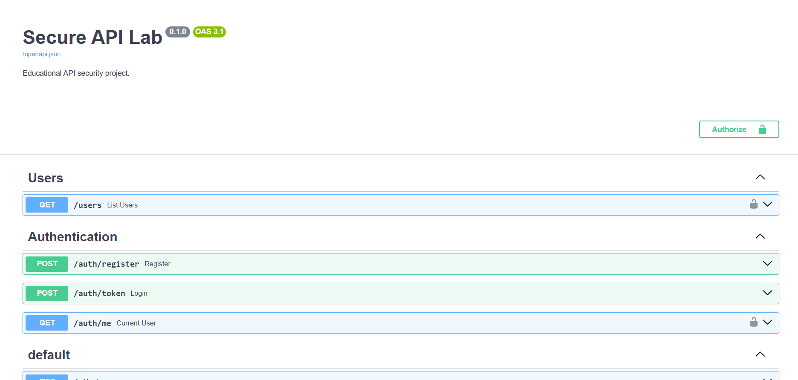
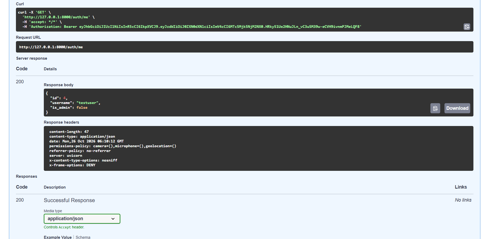
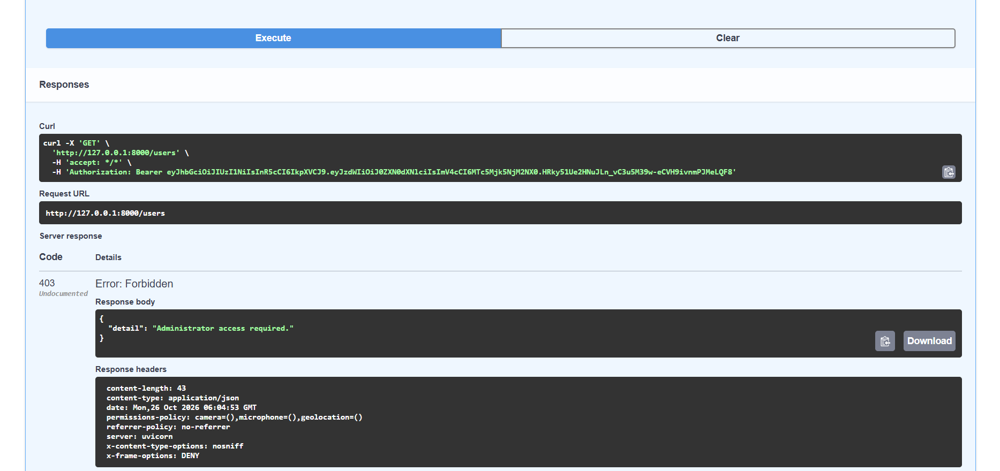

# Secure API Lab

Defensive cybersecurity project focused on building, reviewing, testing, and hardening a REST API.

The project demonstrates how common API security weaknesses can be identified and remediated using authentication, authorization, secure password storage, rate limiting, security headers, secure error handling, logging, and automated security testing.

## Technologies

- Python
- FastAPI
- SQLAlchemy
- SQLite
- Argon2
- JWT
- OAuth2
- pytest
- HTTPX
- SlowAPI
- Git
- GitHub

## Project Goals

This project demonstrates:

- API security fundamentals
- Authentication
- Authorization
- Password hashing
- JWT-based access control
- OAuth2 password flow
- Role-based permissions
- Input validation
- Rate limiting
- Secure error handling
- Security headers
- Secrets management
- Security logging
- Automated security testing
- OWASP-inspired defensive practices

## Security Controls Implemented

- Argon2 password hashing
- JWT authentication
- OAuth2 password flow
- Protected API routes
- Role-based authorization
- Administrator-only endpoints
- Rate limiting
- Security headers
- Secure error handling
- Environment-based secrets
- Security logging
- Automated security tests

## Authentication

Users authenticate through an OAuth2 password flow.

After successful authentication, the API generates a JWT access token that can be used to access protected endpoints.

Protected routes verify the token before allowing access.

## Authorization

The project includes role-based authorization.

Certain routes require administrator privileges.

For example, an authenticated non-administrator user attempting to access an administrator-only endpoint receives:

```text
403 Forbidden
```

with a response similar to:

```json
{
  "detail": "Administrator access required."
}
```

This demonstrates the difference between authentication and authorization.

## Password Security

Passwords are never stored as plain text.

The application hashes passwords using Argon2 before storing them in the database.

Password verification is performed against the stored hash during authentication.

## JWT Security

JWT tokens are used to maintain authenticated sessions.

The API validates tokens before granting access to protected resources.

The project also includes tests that verify JWT creation and validation behavior.

## Rate Limiting

Rate limiting is implemented to reduce abuse and excessive request attempts.

This helps mitigate risks such as:

- Brute-force authentication attempts
- Automated abuse
- Excessive API requests

## Security Headers

The API includes defensive HTTP headers such as:

```text
X-Content-Type-Options: nosniff
X-Frame-Options: DENY
Referrer-Policy
Permissions-Policy
```

These headers help reduce risks related to content sniffing, clickjacking, referrer leakage, and unnecessary browser permissions.

## Secure Error Handling

The project uses centralized error handling to avoid exposing unnecessary internal application details.

Errors are returned in a controlled JSON format instead of exposing stack traces or sensitive implementation information.

## Secrets Management

Sensitive configuration values are managed through environment variables.

The real `.env` file is excluded from version control.

A project repository should never contain production secrets, passwords, API keys, or private signing keys.

## Security Logging

Security-relevant events can be logged to support monitoring and debugging.

Logging is designed to provide useful information without unnecessarily exposing sensitive data.

## Security Lab Approach

The project was developed as a defensive security lab.

The workflow includes:

```text
Initial API
    ↓
Security Review
    ↓
Weakness Identification
    ↓
Security Hardening
    ↓
Automated Security Testing
    ↓
Final Secure API
```

Security findings and remediation decisions are documented in:

```text
docs/VULNERABILITY_ASSESSMENT.md
docs/SECURITY_BEFORE_AFTER.md
```

## Automated Tests

The project includes automated API and security tests.

The current test suite verifies areas such as:

- Health endpoint
- Root endpoint
- Authentication requirements
- Password hashing
- Password verification
- JWT behavior
- Security headers
- Protected user routes

Run the tests with:

```bash
python -m pytest tests -v
```

On Windows using the project virtual environment:

```bash
./.venv/Scripts/python.exe -m pytest tests -v
```

Current project release:

```text
8 passed
```

## Running the API

Install the dependencies:

```bash
python -m pip install -r requirements.txt
```

Start the FastAPI development server:

```bash
python -m uvicorn app.main:app --reload
```

On Windows using the project virtual environment:

```bash
./.venv/Scripts/python.exe -m uvicorn app.main:app --reload
```

Then open the interactive API documentation:

```text
http://127.0.0.1:8000/docs
```

## API Documentation

FastAPI automatically provides interactive Swagger/OpenAPI documentation.

The documentation can be used to:

- Register users
- Authenticate
- Obtain JWT tokens
- Test protected routes
- Test administrator-only routes
- Inspect API responses
- Inspect HTTP response headers

## Screenshots

### Swagger API Documentation



### Authentication



### Role-Based Authorization



The authorization example demonstrates an authenticated user receiving:

```text
403 Forbidden
```

when attempting to access an administrator-only route.

## Project Structure

```text
secure-api-lab/
├── app/
│   └── ...
│
├── docs/
│   ├── screenshots/
│   │   ├── swagger-api.png
│   │   ├── authentication.png
│   │   └── security-response.png
│   │
│   ├── SECURITY_BEFORE_AFTER.md
│   └── VULNERABILITY_ASSESSMENT.md
│
├── tests/
│   ├── test_api.py
│   └── test_security.py
│
├── .env.example
├── .gitignore
├── README.md
├── requirements.txt
└── pyproject.toml
```

## Important

The intentionally vulnerable version of this project is designed only for local educational and defensive security testing.

It should not be deployed publicly.

The purpose of this repository is to demonstrate secure API development and remediation techniques, not offensive exploitation.

## Limitations

This project is a portfolio and educational security lab.

It is not intended to represent a production-ready authentication platform without additional controls such as:

- Production database configuration
- HTTPS enforcement
- Key rotation
- Token revocation
- Monitoring infrastructure
- Centralized audit logging
- Production secret-management services
- Deployment hardening

## Future Improvements

Possible future improvements include:

- Refresh tokens
- Token revocation
- Multi-factor authentication
- PostgreSQL
- Docker
- CI/CD security testing
- Dependency vulnerability scanning
- Centralized monitoring
- Cloud deployment
- Automated secret rotation

## Project Status

Version 1.0.0 represents the first complete portfolio-ready release of Secure API Lab.